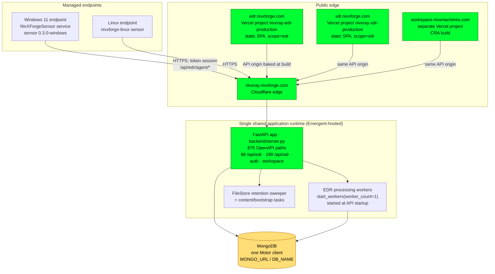
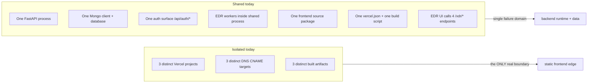
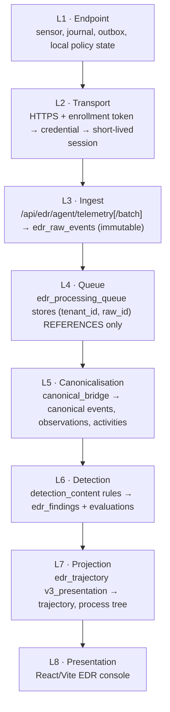

# 01 · System Architecture — as it exists today

## 1.1 Whole-system view

**Green = verified live. Amber = identity unknown** (production MongoDB host/deployment and `DB_NAME` are not readable with current permissions).

### Verified facts behind the diagram

| Fact | Evidence | Class |
|---|---|---|
| `edr.nivxforge.com` → `307 → /edr`, `server: Vercel`, asset `/assets/index-Btpjue2F.js` | HTTP probe | DEPLOY-VERIFIED |
| EDR build provenance `{"product_scope":"edr","api_origin":"https://nivxray.nivxforge.com","built_at":"2026-10-28T16:15:44Z"}` | `GET /build-info.json` | DEPLOY-VERIFIED |
| XDR build provenance: same API origin, `built_at 2026-09-30T17:37:18Z` | `GET /build-info.json` | DEPLOY-VERIFIED |
| Workspace bundle targets the same API origin | bundle inspection | DEPLOY-VERIFIED |
| API origin is Cloudflare-fronted and Emergent-hosted (`__emg_vid`/`__emg_sid`) | response headers | DEPLOY-VERIFIED |
| One FastAPI app serves EDR + XDR + Workspace route families | `GET /api/openapi.json`, 875 paths | DEPLOY-VERIFIED |
| EDR agent plane fail-closed | `/api/edr/agent/whoami` → `401 SENSOR_UNAUTHENTICATED` | DEPLOY-VERIFIED |
| Backend deployment revision / SHA | no build stamp, no platform read | **UNKNOWN** |
| Production Mongo identity and `DB_NAME` | deployment secret, unreadable here | **UNKNOWN** |

## 1.2 Product boundary — where isolation does and does not exist

The product boundary is produced by a **build flag**, not infrastructure: `scripts/vercel-build.sh` sets `NIVX_PRODUCT_SCOPE` (default `xdr`), and its own comment states that `productScope.js` + `ProductScopeGuard.jsx` are the only thing preventing `xdr.nivxforge.com/edr/trajectory` from rendering EDR on the XDR host.

## 1.3 Layer map

Observed ingestion→canonicalisation latency in the lab: **3–6 minutes** (one marker took ~6 min). Any negative test must wait ≥7 minutes before declaring a miss.

## 1.4 Environments

| Environment | Frontend | Backend | Database | Status |
|---|---|---|---|---|
| Production | `edr.nivxforge.com` / `xdr.nivxforge.com` / `workspace.nivxmachines.com` | `nivxray.nivxforge.com` | identity UNKNOWN | live; deployment on HOLD |
| Preview (this workspace) | Vite dev server on `:3000` | supervisor FastAPI on `:8001` | local `mongodb://`, `DB_NAME=test_database` | active development |
| G4 lab | none | `127.0.0.1:8101` (candidate `d2f8b742`) | `nivx_g4_lab` | loopback only; no live route |
| G4-02 isolated VM lab | — | separate Emergent preview | local Mongo | reported, independent |

Production, preview and the local checkout serve a **byte-identical OpenAPI document** (`md5 a8c5abe0…`, 778,868 bytes). That proves identical API *schema only* — it cannot identify the deployed revision, because the frozen candidate changes response content, not schema.
