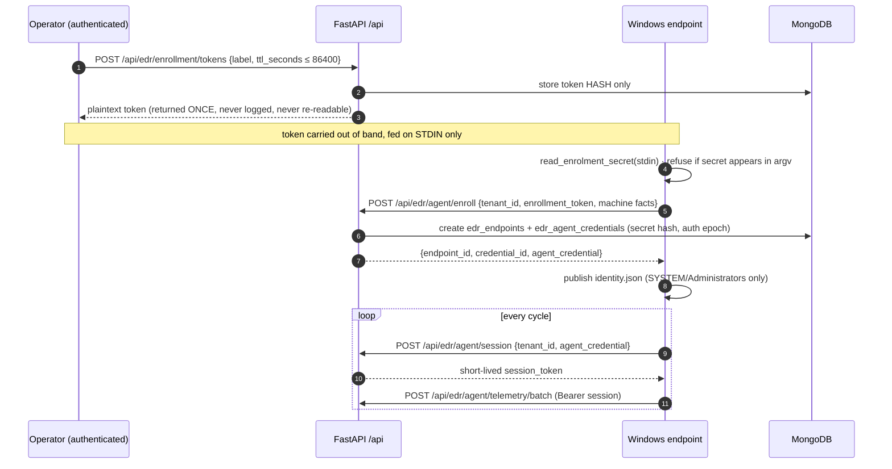
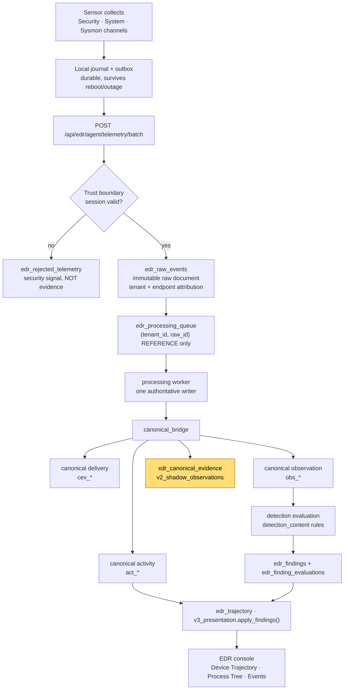
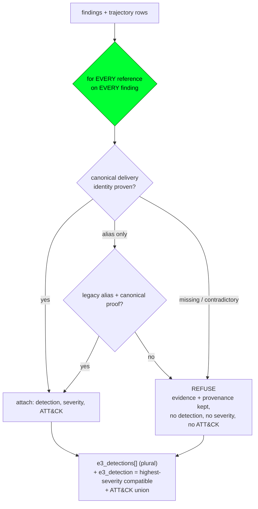
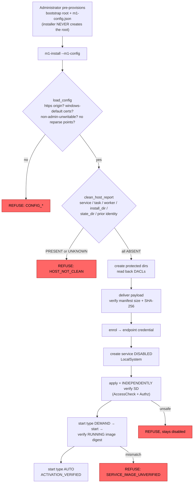
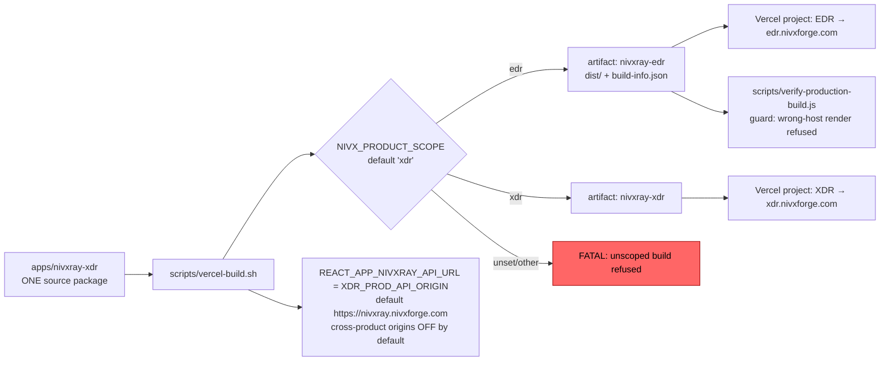
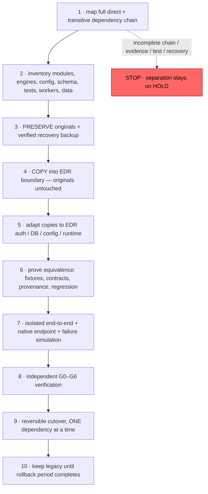

# 02 · Flowcharts

All diagrams are Mermaid. Every flow below is SOURCE-VERIFIED unless marked otherwise.

## 2.1 Endpoint enrollment and session lifecycle



**Fail-closed proof (live):** `GET /api/edr/agent/whoami` with no token → `401 SENSOR_UNAUTHENTICATED`, and the refused payload is retained as a security signal, never as endpoint evidence.

## 2.2 Telemetry → evidence → detection → UI



Amber node = **cross-product data coupling**: the EDR canonical bridge writes into XDR-owned collections.

### Real traced example (G4 lab, read-only verification)

```text
Sysmon EID 1  "NIVX_G4_SYSMON_TEST"  2026-10-30 03:17:41 UTC
  raw_dc73bc44ce9417acdbac4411                 (raw landing)
     → cev_ca4c923e6284b529eaff0b38_0          (canonical delivery)
        → obs_4bb13bc9a03c                     (observation, SOURCE_PROCESS_GUID)
           → act_2a2a87354cf8577b4e90b335      (activity)
              → focus?observation_id=obs_…     → FOCUS_RESOLVED
elapsed raw → canonical: ~6 minutes
```

## 2.3 Finding association (the logic corrected by candidate `d2f8b742`)



The defect fixed: a `if not matched` short-circuit stopped evaluating later references once one finding attached, silently dropping legitimate mixed-reference findings (`attached=1` instead of `attached=2`). The green node is the correction — **every** reference is now evaluated, and refusal is decided only after all of them.

## 2.4 M1 Windows installation (clean-install-only contract)



Service runtime command line (what the SCM actually invokes):

```text
"<install_dir>\NivXForgeSensor.exe" --m1-service-run --m1-config <path>\m1-config.json --state-dir <state_dir>
```

`m1_service_run()` verifies it really is LocalSystem, loads and validates the config **before** binding the state directory, and refuses `CONFIG_STATE_DIR_MISMATCH` if `--state-dir` disagrees with the approved config.

## 2.5 Build and deployment



Backend deploys via the Emergent pipeline to `nivxray.nivxforge.com` — **not** via Vercel. `apps/nivxray-xdr/vercel.json` has no `/api/*` routes; it is SPA rewrites plus two host-scoped `/` redirects only.

## 2.6 Governance gates (G0–G6) and the copy-first isolation sequence



**Current position: step 1, incomplete → HOLD.**
