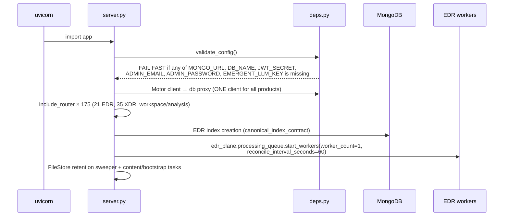
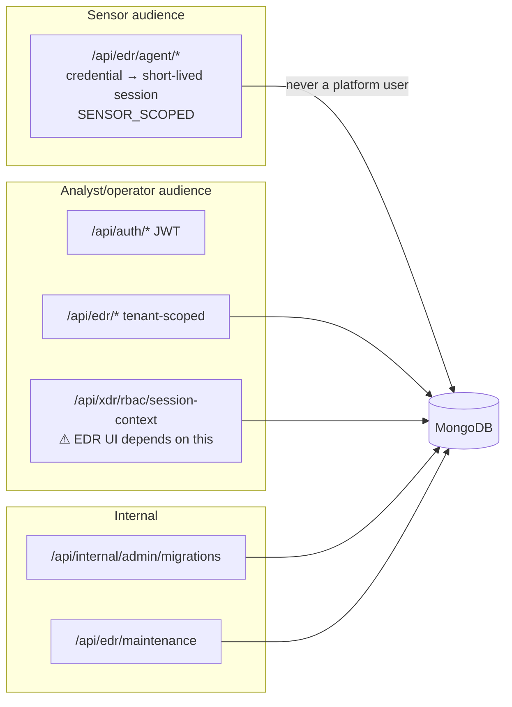

# 03 · Backend Skeleton

## 3.1 Tree (source-file counts, this revision)

```text
backend/
├── server.py                  composition root · 175 include_router calls (21 EDR, 35 XDR)
├── deps.py                    Motor client, db proxy, JWT auth, config validation
│
├── edr_plane/            83   EDR ingest · identity · queue · policy · fabric · response
│   ├── raw_events.py              immutable raw evidence writer
│   ├── processing_queue.py        queue + start_workers(worker_count=1, reconcile=60s)
│   ├── canonical_bridge.py        raw → canonical delivery/observation/activity
│   ├── canonical_index_contract.py  index names and report-mode migration control
│   ├── detection_replay.py        rule evaluation against stored evidence
│   ├── authority.py               tenant/endpoint authority (imports routers.xdr_rbac)
│   ├── enrollment/                store, transport, rejection
│   ├── policy/ · exclusions/ · fabric/ · response.py · delivery_counters.py
│   └── behavior_evidence_adapter.py · reputation.py · file_identity.py …
├── edr_trajectory/       24   v3_presentation.py (candidate-modified) · attack.py ·
│                              production_adapter.py · platform_seed.py · prodshape.py
├── edr_behavior/         15   behavioural evaluation
├── edr_investigation/     6
├── edr_ml/                9
├── routers/edr*.py       17   the EDR API surface (see §3.3)
├── services/edr/          7   endpoint_query · endpoint_health · device_identity ·
│                              file_trajectory · telemetry_freshness · observation_narrative
│
├── services/            378   SHARED platform services (session_context, mitre_catalogue,
│                              dashboard_lenses, activity.projector, …)
├── v2/                  197   SHARED ingestion.canonical · ingestion.telemetry_bridge ·
│                              case_engine.schema · investigation
├── detection_content/   124   XDR-owned rules, registry, rule_store_binding, xdr_pipeline,
│                              telemetry.nivxforge_sensor_dsm  ← imports edr_plane
├── nivxforge/           106   ⚠ NivXRay analysis engines (attribution, cim, learning) —
│                              NOT the EDR product. Used by Workspace/XDR routers.
├── security_state/       81   not import-traced yet
├── decoders/             62   Workspace decoder engines
├── engine/               43   not import-traced yet
├── canonical/            41   not import-traced yet
├── workspace/ · workspace_recovery/ · l2_investigation/ · reasoning/ · training/
└── tests/               962   of which EDR-owned: edr/ 113 · edr_trajectory/ 21 ·
                              edr_behavior/ 7 · edr_investigation+edr_ml 11 · root *edr* 7
```

EDR owns **154 of 1,512** non-test backend modules (10.2 %).

## 3.2 Startup and lifecycle



**Two consequences that govern every extraction plan**

1. An EDR-only route extraction **without** the workers stalls all downstream processing.
2. Two API instances over the same database = **two queue writers**. Exactly one authoritative writer per queue is mandatory.

## 3.3 EDR API surface (router prefixes, SOURCE-VERIFIED)

| Router file | Prefix | Audience | Purpose |
|---|---|---|---|
| `edr.py` | `/edr` | analyst (JWT) | projections, trajectory, endpoint reads |
| `edr_enrollment.py` | `/edr/enrollment` | operator (JWT) | mint/list/revoke tokens, endpoints, rotate, revoke, rejections |
| `edr_enrollment.py` | `/edr/agent` | **sensor** (credential → session) | `enroll`, `session`, `heartbeat`, `telemetry`, `telemetry/batch`, `acquisition-integrity`, `whoami`, `commands`, `command-result`, `command-verification` |
| `edr_onboarding.py` | `/edr/onboarding` | analyst | computers list and detail |
| `edr_events.py` | `/edr/events` | analyst | raw events explorer, facets, by-id |
| `edr_trajectory_v3.py` | `/edr` | analyst | `endpoints/{id}/trajectory[/hours|/file-facts|/attack]` |
| `edr_findings.py` | `/edr/findings` | analyst | findings, evaluation-state, taxonomy |
| `edr_policies.py` | `/edr/policies`, `/edr/groups`, `/edr/agent` | analyst + sensor | policy CRUD, groups, agent policy + ack |
| `edr_response.py` | `/edr/response`, `/edr/agent` | analyst + sensor | actions, commands, results, verification |
| `edr_exclusions.py` | `/edr/exclusions` | analyst | exclusion sets and enforcement |
| `edr_audit.py` | `/edr/audit` | analyst | enrollment/policy audit trail |
| `edr_session.py` | `/edr/session` | analyst | EDR session/tenant context |
| `edr_saved_views.py` | `/edr/saved-views` | analyst | saved queries |
| `edr_connector.py` | `/edr/connector` | operator | connector/installer releases |
| `edr_wave0.py` | `/edr/wave0` | analyst | wave-0 detection surface |
| `edr_maintenance.py` | `/edr/maintenance` | operator | maintenance (⚠ tenant-wide reset exists — never use for scoped deletes) |
| `edr_migration_control.py` | `/internal/admin/migrations` | internal | report-mode index/migration control |
| `edr_tenancy.py` | — | middleware | route→scope authority map (`SENSOR_SCOPED`, …) |

Live counts: **86** `/api/edr/*` paths of 875 total.

## 3.4 Configuration contract

```python
# backend/deps.py
_REQUIRED_ENV = ("MONGO_URL", "DB_NAME", "JWT_SECRET",
                 "ADMIN_EMAIL", "ADMIN_PASSWORD", "EMERGENT_LLM_KEY")
```

Plus EDR-specific keys observed in the environment (names only): `EDR_AUTH_PEPPER`, `EDR_AGENT_SESSION_TTL_SECONDS`, `EDR_ENROLLMENT_TOKEN_TTL_SECONDS`, `EDR_MAINTENANCE_TOKEN`, and the `NIVX_FLAG_*` / `NIVX_ENGINE_*` family.

**Observation for the target design:** the telemetry ingestion path does not need `EMERGENT_LLM_KEY` or admin seeding, yet startup refuses without them. An EDR-only runtime should require only what EDR uses — **without** weakening fail-closed auth.

## 3.5 Trust boundaries



Refused agent payloads are retained as **security signals** in `edr_rejected_telemetry`, explicitly not as endpoint evidence.
