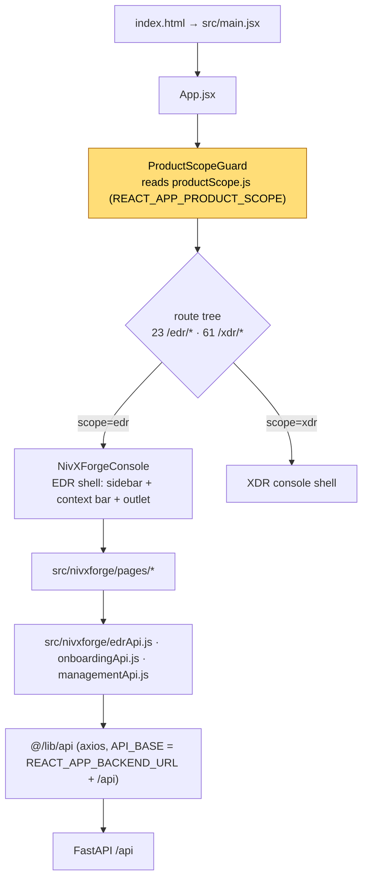
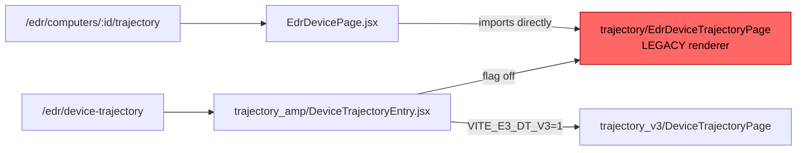

# 04 · Frontend Architecture and UI/UX

## 4.1 Application shell



`ProductScopeGuard` is the **only** mechanism keeping EDR screens off the XDR host — a build-time boundary, flagged as a risk rather than a control.

## 4.2 EDR route map (23 routes, SOURCE-VERIFIED from `App.jsx`)

| Route | Screen | State |
|---|---|---|
| `/edr` | `EdrOverviewPage` | implemented |
| `/edr/login` | scoped login | implemented |
| `/edr/computers` | `EdrComputersPage` — fleet inventory | implemented |
| `/edr/computers/add` | `EdrAddDevicePage` — onboarding | implemented |
| `/edr/computers/:endpointId` · `/:tab` | `EdrDevicePage` — device detail with tabs | implemented ⚠ Trajectory tab mounts the **legacy** renderer |
| `/edr/device-trajectory` | `DeviceTrajectoryEntry` → V3 when `VITE_E3_DT_V3=1`, else legacy | flag-gated |
| `/edr/trajectory` | `EdrTrajectoryResolver` — deep-link/compat resolver | implemented |
| `/edr/events` | `EdrEventsPage` — raw events explorer + facets | implemented |
| `/edr/detections` | `EdrDetectionsPage` | implemented |
| `/edr/process-tree` | `EdrProcessTreePage` | implemented |
| `/edr/campaign-story` | `EdrCampaignStoryPage` | implemented |
| `/edr/policies` | `EdrPoliciesPage` | implemented |
| `/edr/exclusions` | `EdrExclusionsPage` | implemented |
| `/edr/response` | `EdrResponsePage` | implemented ⚠ depends on `/xdr/respond/*` |
| `/edr/audit` | `EdrAuditPage` | implemented |
| `/edr/management` · `/management/downloads` | `EdrDownloadsPage` — installer releases | implemented |
| `/edr/files` · `/forensics` · `/hunting` · `/live-query` · `/network` | `EdrNotImplementedPage` / `EdrReservedPages` | **reserved placeholders — honest "not implemented", not stubs pretending to work** |

### Known routing defect (SOURCE-CONFIRMED, not fixed)



The device tab therefore **bypasses V3**. A blind swap is unsafe: the V3 page reads `?device=` and owns its own console wrapper, so embedding it directly risks the wrong device and nested shells. It needs a narrow, separately reviewed route/context patch.

## 4.3 Component inventory (`src/nivxforge/`, 102 files)

```text
src/nivxforge/
├── NivXForgeConsole.jsx       product shell (imported by 17 modules)
├── EdrSidebar / ampModel      navigation + shared view model
├── edrApi.js                  EDR API client  ⚠ also calls 4 /xdr/* endpoints
├── onboardingApi.js · managementApi.js
├── pages/                     15 page components (table above)
├── device/EdrDevicePage.jsx   device detail with tabs
├── components/
│   ├── OpsPrimitives          shared table/panel/badge primitives (10 importers)
│   ├── TelemetryFreshness     per-endpoint ingestion health
│   ├── EndpointNotResolved    explicit "no evidence" state
│   ├── LinkedXdrIncidents     cross-product pivot
│   └── CustomerPicker         tenant selector
├── trajectory/                LEGACY device trajectory
├── trajectory_amp/            E3 contract entry + flags.js
└── trajectory_v3/             current generation
    ├── DeviceTrajectoryPage.jsx
    └── amp/  TrajectoryPage · Grid · Activity · Artifacts · AttackStrip ·
              Filters · Glyphs · Header · Menu · MitreBox · Navigator ·
              model.js · fields.js · labels.js · attack.js · theme.js · perf.js
              + __tests__ (13 test files across 3 __tests__ dirs)
```

## 4.4 Design system (from `design_guidelines.json`)

**Archetype:** *The Performance Pro — Swiss & high-contrast*. Default mode **dark**, light supported via `.xdr-console[data-nx-theme='light']`.

| Token | Dark | Light |
|---|---|---|
| canvas | `#0B0E14` | `#F8FAFC` |
| surface primary / inset / raised | `#121721` / `#0E131C` / `#1A212D` | `#FFFFFF` / `#F1F5F9` / `#FFFFFF` |
| border quiet / strong | `rgba(255,255,255,.08)` / `.14` | `#E2E8F0` / `#CBD5E1` |
| text primary / dim / muted / faint | `#F1F5F9` / `#CBD5E1` / `#94A3B8` / `#7C8AA0` | `#0F172A` / `#334155` / `#475569` / `#64748B` |
| accent (brand amber) | `#F59E0B` | `#D97706` |

**Typography** — display *Outfit* 700/800 tracking-tight (titles, hero metrics); body *IBM Plex Sans* 400/500/600; mono *JetBrains Mono* for channel IDs, event IDs, DSM IDs, tokens and timestamps.

**Scale** — `h1` 24px bold tracking-tight · `h2` 18px semibold · `h3` 14px semibold uppercase tracking-wide · body 12px leading-relaxed · mono token 11px · KPI 24px extrabold.

**Motion** — hover `transition-colors 150ms ease-in-out`; drawers `framer-motion ease-out 200ms`. Deliberately restrained: this is an evidence console, not a marketing surface.

**Status vocabulary** is a first-class design token set (`RECEIVING`, `CONFIGURED`, `AVAILABLE_NOW`, `GAP_DETECTED`, …) with tone + bg/text/border per theme, so a status badge can never be invented ad hoc per screen.

## 4.5 UX principles enforced in code

1. **Honest empty states.** `EndpointNotResolved` and `EdrNotImplementedPage` distinguish *no evidence*, *not resolved* and *not implemented* — a zero is never rendered as if it were a measured zero.
2. **Evidence identity is visible.** Raw IDs, observation IDs and channel/event IDs are rendered in mono so an analyst can cite them.
3. **Deep links carry context.** Tenant / customer / endpoint / incident / detection / time range live in the query string, so a pivot survives becoming cross-origin.
4. **Freshness is surfaced, not assumed.** `TelemetryFreshness` shows ingestion health per endpoint rather than implying liveness from a row existing.
5. **Refusal is a UI state.** Trust-boundary refusals and unresolved associations render as explicit refusals with provenance, never as silent omissions.

## 4.6 Cross-product UI coupling (blocks independent build)

| Import | Count | Owner |
|---|---|---|
| `@/lib/api` | 11 | shared |
| `@/xdr/nx/apiError` | 10 | **XDR** |
| `@/lib/tenant` | 3 | shared |
| `@/xdr/lib/pivots` | 1 | **XDR** |
| `@/xdr/lib/mitre/navigatorLayer` | 1 | **XDR** |
| relative escapes `../../ampModel`, `../../EdrSidebar` | 3 | shared |

**Reverse:** 8 XDR files import EDR code — `ActivityDetailsPanel`, `StaticAnalysisBridge`, `XdrContextBar`, `XdrEndpointsPage`, `XdrControlCenterPage`, `XdrFleetFileTrajectoryPage`, `XdrEntity360Page`, `assets/AssetsPage`. Under the isolation directive these originals stay untouched; EDR takes a copy.

**Runtime:** `edrApi.js` calls `/xdr/rbac/session-context`, `/xdr/respond/actions`, `/xdr/respond/health`, `/xdr/respond/pending-approvals` — these must be replaced by EDR-owned authority in the EDR copy.

## 4.7 Test-id convention

Interactive and evidence-bearing elements carry kebab-case `data-testid` naming the function, e.g. `edr-computers-table`, `device-trajectory-grid`, `telemetry-freshness-badge`. 13 frontend test files drive these; EDR frontend suite previously reported **290 passing across 17 files**.
