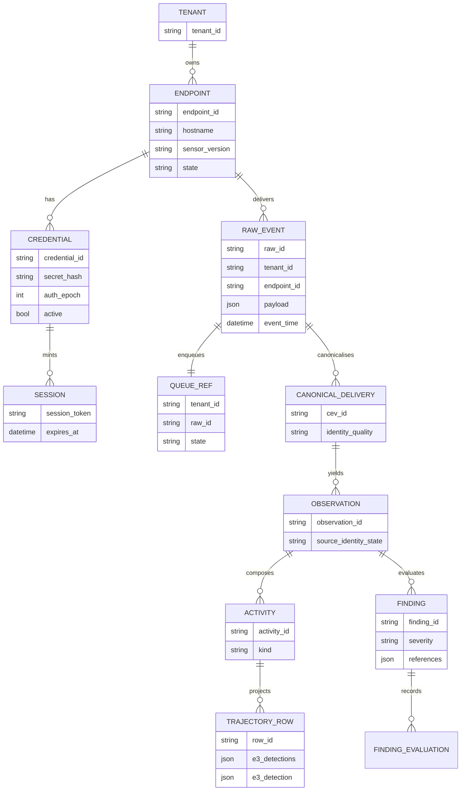

# 05 · Data Model

## 5.1 Collection inventory (referenced in `edr_plane` / `routers/edr*`)

| Family | Collections | Owner | Migration sensitivity |
|---|---|---|---|
| Endpoint identity | `edr_endpoints`, `edr_agent_credentials`, `edr_agent_sessions`, `edr_enrollment_tokens` | EDR | **security-sensitive** — credential migration changes trust |
| Primary telemetry | `edr_raw_events` | EDR | authoritative immutable raw store — never duplicate, never purge before attribution proof |
| Queue & delivery | `edr_processing_queue`, `edr_delivery_counters`, `edr_acquisition_integrity`, `edr_acquisition_gaps` | EDR | references + counters must reconcile |
| Policy & config | `edr_policies`, `edr_policy_versions`, `edr_policy_endpoint_state`, `edr_groups`, `edr_exclusions`, `edr_exclusion_sets`, `edr_endpoint_exclusion_enforcement`, `edr_isolation_policy` | EDR | tenant/endpoint scope must be preserved |
| Detection & response | `edr_findings`, `edr_finding_evaluations`, `edr_response_commands`, `edr_compromise_events` | EDR | evidence references must survive |
| Audit & refusals | `edr_enrollment_audit`, `edr_policy_audit`, `edr_rejected_telemetry` (+ `*_all_tenants` views) | EDR | retention separate from telemetry deletion |
| Addressing & views | `edr_endpoint_address_observations`, `edr_saved_views`, `edr_connector_deployments`, `edr_tenant_boundary` | EDR | — |
| **Cross-product derived** | `xdr_canonical_evidence`, `v2_shadow_observations` | **shared / XDR** | written by the EDR canonical bridge — **not safe to move or delete** |

## 5.2 Identity chain (the spine of all evidence)



Real ID shapes observed end-to-end: `ten_…` → `ep_…` → `raw_…` → `cev_…_0` → `obs_…` → `act_…`.

## 5.3 Rules that are load-bearing

1. **Queue holds references, not payloads.** `edr_processing_queue` stores `(tenant_id, raw_id)`. Copying raw JSON into the queue would create a second authoritative raw record.
2. **One authoritative raw event per immutable source identity.** Deduplicate by tenant + canonical endpoint ID + immutable event/raw ID + source record identity — **never by hostname** and never by timestamp or count equality.
3. **Association requires proven canonical-delivery identity.** Source references are locators only. Missing, ambiguous or contradictory identity **fails closed**: provenance is kept, detection/severity/ATT&CK are withheld.
4. **Tenant isolation is caller-enforced for `apply_findings()`.** The function itself receives no tenant context; both active callers filter via `store.read(tenant, …)`. Any new caller must do the same — this is a documented residual risk, not a defect.
5. **No enforced unique index on `observation_id`** upstream; association fails closed around that gap.
6. **Refused telemetry is a security signal**, stored apart from evidence and never promoted into it.

## 5.4 Index contract and a real environment hazard

`edr_plane/canonical_index_contract.py` + `routers/edr_migration_control.py` implement **report-mode** migration control: it names the exact indexes it would create and verifies what exists, without mutating.

Observed preview drift (classified as pre-existing environment state, not a code defect):

```text
reported_name=sd_canonical_endpointid_eventtime   state=WOULD_CREATE
reported_name=pvw_sd_hostname_eventtime           state=ALREADY_PRESENT_VERIFIED
expected                                          sd_canonical_hostname_eventtime
```

A legacy hostname index carries a byte-identical key under a different name, so a strict name assertion fails on that database while passing 19/19 on a clean one. **Lesson for migration: assert on index keys and names separately.**

## 5.5 Data-boundary questions still open (A0-03 scope)

- Which product reads and which writes each collection, per route and per worker.
- Foreign/shared references between `edr_*` and `xdr_canonical_evidence` / `v2_shadow_observations`.
- Per-collection document counts and index sizes in production.
- Retention policy owner per family.
- Reconciliation of acquired → accepted → unique-raw → canonical → rendered cardinality.

Until these are mapped, **no database separation may begin** (isolation directive, step 2, plus the prohibition on bulk cloning).
