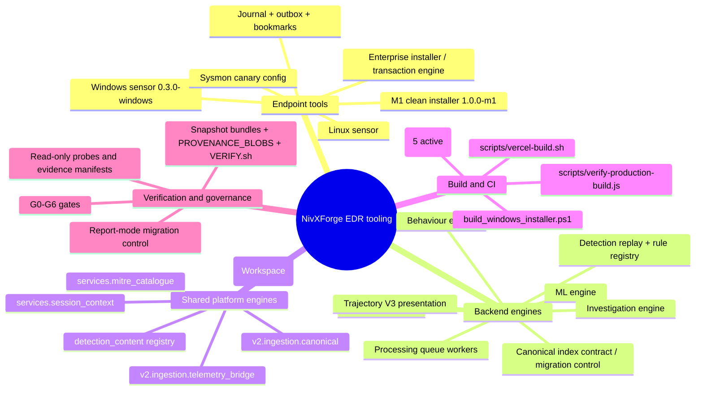
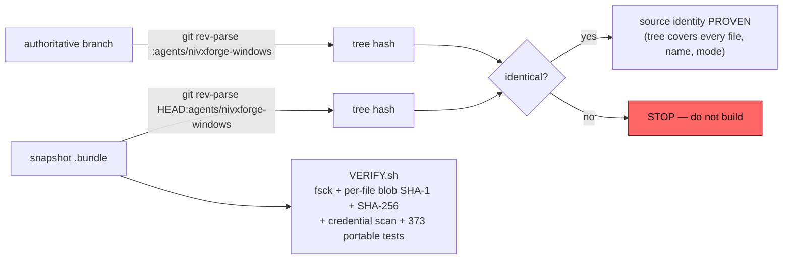

# 06 · Tools and Engines Architecture

## 6.1 Tool landscape

## 6.2 Endpoint tooling

| Tool | Path | Identity | Contract |
|---|---|---|---|
| Windows sensor | `agents/nivxforge-windows/nivxforge_sensor.py` | `SENSOR_VERSION = "0.3.0-windows"` | collects `Security`, `System`, Sysmon channels; `CAPABILITIES.collects = ["WINDOWS_EVENT_LOG"]`; declares `fields_not_supported` (`process.sha256`, `registry.*`, `usb_device.*`, `memory.*`, …) and `response_actions = []` |
| M1 clean installer | `nivxforge_m1.py` (branch `engineering/m1-g3-integrated`) | `M1_VERSION = "1.0.0-m1"` | clean-install-only; refuses any non-clean host; ownership record with `CREATE_INTENDED/CONFIRMED/OUTCOME_UNKNOWN/ACTIVATION_VERIFIED` states |
| Enterprise installer | `nivxforge_setup.py` | — | `install/uninstall/status/stage-host/journal-selftest` + `m1-install/m1-uninstall/m1-reconcile-enrollment` dispatch |
| Journal | `nivxforge_journal.py` | — | durable acquisition journal; survives reboot and backend outage |
| Exclusions | `agents/_shared/nivxforge_exclusions.py` | — | shared by Windows and Linux sensors only |
| Installer builder | `build/build_windows_installer.ps1` | PyInstaller 6.11.1 + pywin32 308 | one-file `NivXForgeEDRSetup.exe` embedding `service/NivXForgeSensor.exe` + `payload-manifest.json`; emits SHA-256 + `signing_status = UNSIGNED_INTERNAL_VALIDATION_BUILD` |

**Honesty property worth preserving:** the sensor publishes what it *cannot* collect. Capability claims are machine-readable, so the UI can show "not supported" instead of an empty chart implying zero.

## 6.3 Engine responsibilities and ownership

| Engine | Location | Owner | Input → Output | Notes |
|---|---|---|---|---|
| Processing queue workers | `edr_plane/processing_queue.py` | EDR | queue refs → processed evidence | exactly one authoritative writer; reconcile every 60 s |
| Canonical bridge | `edr_plane/canonical_bridge.py` | EDR code / shared outputs | raw → delivery, observation, activity, XDR canonical | writes cross-product collections |
| Detection replay | `edr_plane/detection_replay.py` | EDR consumer | observations + rules → findings | depends on `detection_content` registry (XDR-owned) |
| Trajectory V3 | `edr_trajectory/v3_presentation.py` + `routers/edr_trajectory_v3.py` | EDR | activities + findings → trajectory rows with `e3_detections[]` | the module corrected by candidate `d2f8b742` |
| Behaviour | `edr_behavior/` (15) | EDR | observations → behavioural evaluation | |
| ML | `edr_ml/` (9) | EDR | features → scores | flag-gated |
| Investigation | `edr_investigation/` (6) | EDR | evidence → investigation surface | |
| Index contract / migration control | `edr_plane/canonical_index_contract.py`, `routers/edr_migration_control.py` | EDR | DB state → report | report-mode, non-mutating |
| Canonical normalisation | `v2/ingestion/canonical.py` | **shared** | source record → canonical shape | copy with tests or consume as a library — never fork |
| Telemetry bridge | `v2/ingestion/telemetry_bridge.py` | **shared** | canonical → platform ingest | |
| ATT&CK catalogue | `services/mitre_catalogue.py` | **shared** | technique IDs → metadata | |
| Session/tenant authority | `services/session_context.py`, `routers/xdr_rbac.py` | **XDR/shared** | token → scope | EDR authority derives from this today |
| Sensor DSM | `detection_content/telemetry/nivxforge_sensor_dsm.py` | **XDR** → imports `edr_plane` | sensor shape → detection model | **reverse dependency** |
| NivXRay attribution / CIM / learning | `backend/nivxforge/` (106) | **Workspace/XDR** | — | ⚠ not the EDR product despite the name |

## 6.4 CI and quality gates

| Workflow | Purpose |
|---|---|
| `windows-sensor-installer.yml` | builds/validates the Windows installer (manual-only, SCM worker quarantined per security PR #19) |
| `rc4x_quality_gate.yml`, `rc5_gates.yml`, `rc5_golden_corpus_gate.yml` | platform quality and golden-corpus gates |
| `docs-screenshots.yml` | documentation assets |
| `rc23_quality_gate.yml.retired` | retired, retained for provenance |

Reference CI evidence: run `41030823789` PASS for the G4 corrected installer candidate `4cfb7cb0`.

## 6.5 Verification tooling (how claims are proven, not asserted)

Established reference values: M1 subtree `db21f422561f14fb4dcec91b70925f2b5291c500` at candidate `388bb3d6…`; 18/18 blobs byte-identical; `VERIFY.sh` passes 373 portable tests.

**On-VM provenance check (read-only):** compare the installed service image hash against `m1-ownership.json` → `resources.service.evidence.service_image.sha256`. The installer hashed the image before registering the service, so that record is authoritative for what was installed.

## 6.6 Test architecture

| Suite | Count | Last known result |
|---|---|---|
| `backend/tests/edr/` | 113 modules | part of `2453 passed, 1 failed, 3 skipped` (the failure = preview index-name drift, see `05_DATA_MODEL.md` §5.4) |
| `backend/tests/edr_trajectory/` | 21 modules | **665 passed, 0 skipped, 0 xfail** |
| `backend/tests/edr_behavior/` | 7 | included above |
| `backend/tests/edr_investigation/` + `edr_ml/` | 11 | — |
| root-level `*edr*` | 7 | — |
| Frontend EDR | 13 files / 3 `__tests__` dirs | **290 passed in 17 files** |
| M1 portable suite | `backend/tests/edr/test_m1_clean_install.py` + snapshot | **373 passed** |

Portable tests prove logic self-consistency. They do **not** prove real SCM, ACL, Authz, token, filesystem or telemetry behaviour — that is what native G4 testing exists for.
