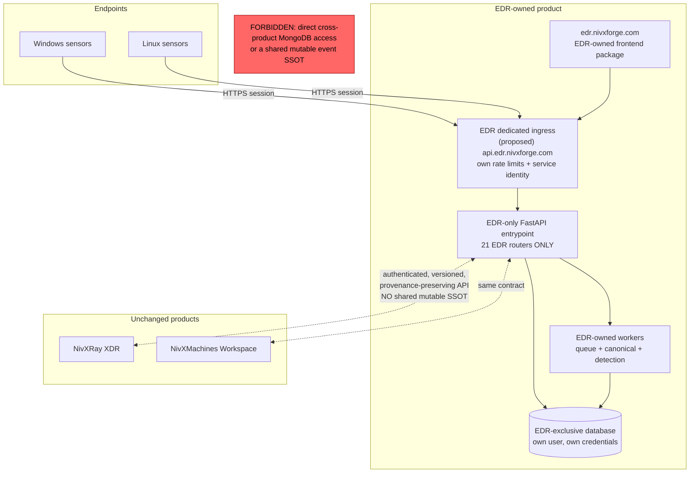
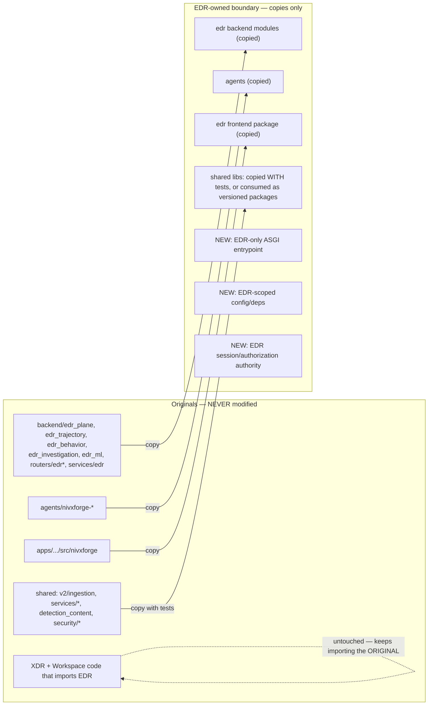
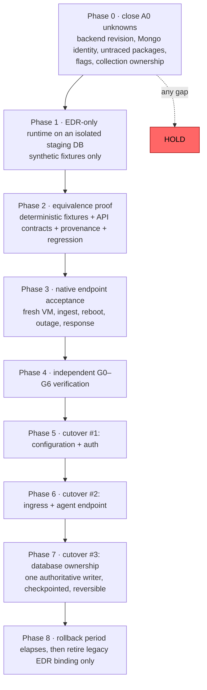

# 07 · Target Independent EDR Architecture (design only)

> **Nothing here is authorized.** Per `/app/memory/EDR_ISOLATION_DIRECTIVE.md` the separation is on **HOLD** until step 1 of the mandatory sequence is complete. This file is a blueprint, not a plan of record.

## 7.1 Target topology

**Definition of independent:** EDR can enrol agents, accept/store/process telemetry, detect, investigate endpoint evidence and execute its supported response actions **while XDR and Workspace are down**. Shared *code* via versioned packages is fine; shared *runtime state* is not.

## 7.2 Copy-first migration map

### What must be newly authored (small, additive)

| # | Component | Replaces | Why it cannot be copied |
|---|---|---|---|
| N1 | EDR-only ASGI entrypoint owning worker + index startup | `server.py` composition root | `server.py` is shared by all three products; copying it would carry XDR/Workspace routers and tasks |
| N2 | EDR-scoped config/deps | `deps.py` 6 mandatory keys | EDR ingestion needs no LLM key or admin seeding — but fail-closed auth must be preserved, never weakened to make startup pass |
| N3 | EDR session/authorization authority | `routers.xdr_rbac` + 4 `/xdr/*` frontend calls | prohibition 4 forbids a new runtime dependency on XDR |

### Reverse dependencies — the inversion that must happen first

| Consumer (stays) | Imports | Required treatment |
|---|---|---|
| `detection_content.telemetry.nivxforge_sensor_dsm` | `edr_plane`, `edr_plane.canonical_bridge` | keeps importing the **original**; EDR's copy is additive. Later: a versioned sensor-shape package consumed by both |
| `detection_content.xdr_pipeline` | `edr_plane` | same |
| 8 XDR UI files | `src/nivxforge/*` | keep importing the original package; EDR's copy is separate until a published package exists |

**Never** cut these edges to make EDR independent — that is prohibition 2.

## 7.3 Dependency cutover order (one at a time, each reversible)

## 7.4 Acceptance criteria for "independent"

1. EDR starts with **only** its own database, config and secrets; fail-closed auth verified, not bypassed.
2. Zero runtime calls from EDR to any `/xdr/*` or Workspace endpoint.
3. Enrolment, session, batch ingest, queue, canonical bridge, detection, Device Trajectory and Process Tree all pass on the isolated runtime.
4. Deterministic-fixture equivalence against the original: identical raw IDs, queue refs, canonical IDs, findings and trajectory rows — **zero unexplained missing or extra records**.
5. Native endpoint acceptance on a fresh VM, including reboot continuity and backend-outage recovery with no raw gaps.
6. XDR, Workspace and NivX Machines verified **unchanged** — their imports, routes and data still resolve to the untouched originals.
7. Rollback rehearsed and proven **before** any cutover.
8. Independent G0–G6 sign-off recorded with evidence.

## 7.5 Cost and isolation honesty

Separate logical databases/users on an existing MongoDB instance give **service isolation** cheaply; they do **not** give independent hardware failure domains. True production availability isolation has a hosting cost and must not be promised for free. Staging may legitimately run on the ASUS Hyper-V host with the VM powered off between sessions.
