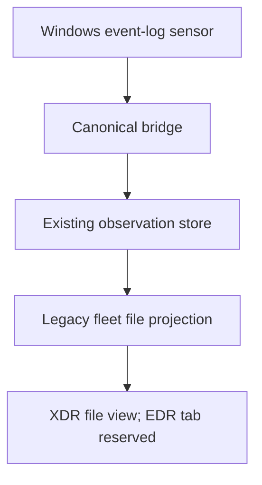
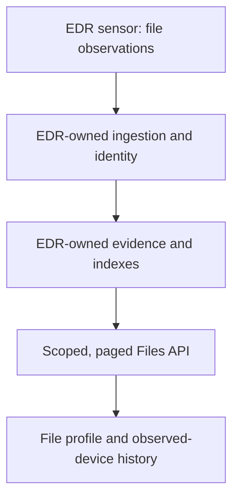
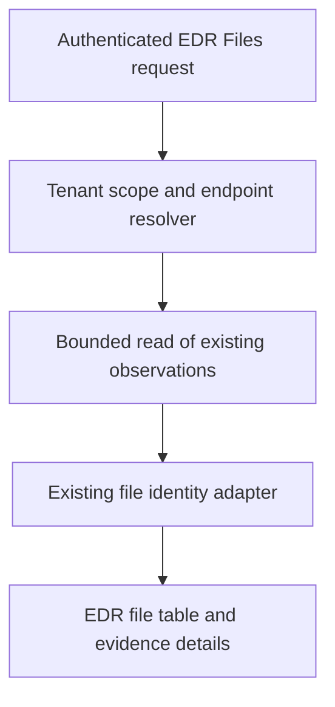

# File Trajectory — Slice 1 architecture and implementation record
Date: 2026-11-01
Status: DRAFT IMPLEMENTATION; not release-ready, no production promotion.
Baseline: jpreddy017/nivxray-xdr @6a05a66bb6d66d2bc222a548d8c89c466f167703.
Work branch: feature/edr-file-trajectory-slice1.

## Analyst question
Which file observations were recorded for this endpoint in a selected UTC window, what content identity is actually known, and which source-stated process acted on the file?

## Research and comparison
Read official vendor documentation before implementation:
- Cisco Secure Endpoint user guide: https://docs.amp.cisco.com/en/SecureEndpoint/Secure%20Endpoint%20User%20Guide.pdf
- Cisco best practices, File Trajectory: https://www.cisco.com/c/en/us/products/collateral/security/fireamp-endpoints/secure-endpoint-og.html
- Microsoft file investigation: https://learn.microsoft.com/en-us/defender-endpoint/investigate-files

Cisco provides a file-centered history across computers; Defender provides file profiles and observed-device pivots. The bounded NivX slice implemented here answers the device-scoped evidence question first. Fleet-wide content prevalence, graph views, file retrieval, reputation enrichment and response are TARGET work, not capabilities claimed by this slice. Vendor references are functional comparisons, not API compatibility or a pixel-parity certification.

## Current baseline architecture
The sensor can acquire Sysmon file events. Optional content acquisition exists and is off by default. The bridge writes normalized observations. A file identity adapter and an older tenant-wide file trajectory service exist; its presentation is XDR-hosted. EDR Files/device Files are reserved. The old UI claim that all Windows file observation is absent is too broad.

## Target architecture
The long-term target is an EDR-owned evidence pipeline, correct source file identity, bounded event-time queries, endpoint and tenant-wide same-content views, provenance and scoped pivots. Preserve and validate dependencies before separation; do not disconnect existing products.

Target extensions:
- File profile with known paths/names, signer/type/size when observed.
- Same-content prevalence across explicitly authorized endpoints using a real file-content digest.
- Event-time timeline and process pivots with proven identities and completeness states.
- Independent EDR runtime/storage after preservation and isolation verification.
- Explicit collection/analysis/response workflows in later slices, never enabled by an investigation UI.

## Implemented architecture — draft code
No second canonicalizer, decoder, file identity engine, collection or evidence writer was added. The new read projection uses edr_plane.file_identity.from_observation and the existing endpoint resolver/registered-store predicate. It reads the current observation store, which still belongs to the shared deployment topology. This is not completion of product separation.

API: GET /api/edr/endpoint-file-observations.
Required: endpoint_id, time_start/time_end in UTC milliseconds.
Optional: key_type=path|name|sha256, key, limit1..200, cursor.
Window: increasing, half-open, maximum31days.
Authorization: existing get_current_user, edr_tenant, edr_scope and EndpointResolution.predicate.
Unresolved endpoint: existing unresolved envelope, not an empty-evidence assertion.
Read failure:503; invalid query/cursor:422.
Source: v2_shadow_observations; no writes or migrations.
Bound: maximum1000 consumed source records per request, maximum200 returned observations, Mongo execution bound3000ms.
Order: Mongo source _id descending, explicitly NOT event-time order.
Cursor: last consumed ObjectId + version + query/customer context digest. Context binding is not authentication; every continuation repeats authoritative authorization and scoping.
Concurrent semantics: higher new IDs do not reappear when continuing below the previous ID. No snapshot isolation or protection against historical inserts with lower IDs is claimed.
Paging can return0file matches with a continuation; UI says scan incomplete and offers continuation.
Early/late observed times refer to source facts; this slice does not compute global first/last or identify an origin.
Hash filter reads only the file-content hash set. Process-image and telemetry-payload digests cannot satisfy it. Invalid source hashes are omitted.
Rows stay as distinct source observations, keyed by record_id; no global event deduplication or propagation claim.

UI:
- /edr/files selects a computer.
- /edr/computers/:endpointId/files uses the same FileEvidence component.
- Explicit UTC start/end and exact filter form; no request before submission.
- Shows recorded time, path, operation, hash availability and Inspect.
- Inspect exposes identity strength, source-stated writer, signer/size if observed, evidence reference, source record and NOT_ASSESSED.
- Continue scanning appends records and retains selected details.
- Device Trajectory link preserves endpoint/window. It does not invent a trajectory event IID from an observation reference.
- Device-tab navigation now preserves query context.
- Requests cancel on replacement; stale results ignored. Customer context events clear loaded evidence; customer picker also reloads the product.
- API unavailable, unauthorized, unresolved identity, incomplete scan and no matching observations have different messages.
- Uses existing theme variables and responsive overflow/form layout. Visual light/dark QA remains open.
- This slice replaces the reserved Files route import and device placeholder; other reserved capabilities are unchanged. Capability registry is not upgraded to runtime-verified. Registry/UI reconciliation is a release gate.

## Flows
Current: sensor → canonical ingestion → observations → older fleet projection → XDR-hosted view; EDR Files reserved.
Target: EDR sensor → independent EDR evidence → content identity → scoped paged Files API → endpoint/fleet file investigation.
Implemented: Files form → validated window/filter → tenant/endpoint resolver → bounded record scan → reused file adapter → evidence table → Inspect → optional trajectory-window pivot.
Failure: invalid request→422; unauthorized tenant→existing denial; unresolved endpoint→identity state; Mongo failure→503; zero matches with next cursor→continue scanning; no observed digest→hash unknown.

## Verification executed
- Python compile check of downloaded baseline modules and changed backend files: PASS.
- 22 stdlib unittest tests: PASS. Actual file identity adapter and canonical constants used, not reimplemented stand-ins.
- 14 React behavior assertions: PASS, React18 renderer and esbuild, mocked router/API.
  Checks include explicit submission, endpoint scope, unknown hashes, append, selection retention, stale endpoint response discard,403, empty partial scan, customer context clearing.
- Isolated remote run at cb10b229: 27 tests passed in1.159s (the then21 projection tests +6 real Mongo integration tests). The additional malformed-record case passed locally afterward.
- Real Mongo checks use only a new UUID-named local test database, remove their own fixtures and never read application database configuration. They cover actual ObjectId continuation, customer/endpoint predicates, context refusal and new inserts.
- FastAPI200/422 exercised using real read code and Mongo, with identity/customer boundary mocked; this does not establish full authentication coverage.
- Vercel EDR preview build for cb10b229: successful combined status; final head build verification tracked separately.
- No production data/config changes, sensor settings, purge execution or promotion.
The author-run checks are not independent G3 review.

Reproduce:
python -m unittest discover -s backend/tests/edr -p test_endpoint_file_evidence.py -v
NIVX_TEST_NODE_MODULES=/absolute/test-runtime/node_modules node tools/test-edr-file-evidence.cjs
The focused React harness needs esbuild, react18 and react-test-renderer18 in that test-runtime directory. These are test tooling, not new product runtime dependencies.

## Open release gates / limitations
1. Full authentication/identity integration with real session authority; the lower-level Mongo scoping tests passed with an explicit endpoint resolution.
2. FastAPI authenticated route checks, identity refusal and503 handling.
3. Existing endpoint identity guard and relevant regression suites in a complete backend environment.
4. Full Vite production build and EDR/XDR guard checks.
5. Light/dark browser, keyboard and narrow-screen verification.
6. Real Sysmon file event through sensor→ingestion→API→browser, with hashing both unavailable and valid. No sensor capability claim until measured.
7. Deep-link/back navigation and customer-switch checks in the real shell.
8. Independently review architecture and code. Existing registry prose discrepancies must be reconciled against runtime behavior.
9. This bounded scan can require many continuation requests on process-heavy endpoints. It intentionally avoids an unbounded full-tenant read. Indexed event-time file projections remain a performance target before fleet scale.
10. Authoritative G0–G6 full assessment was not located in source/library search. Do not claim any gate passed from these author-run checks or redefine the owner's gates.

## Governance / preservation / rollback
New files and EDR route/UI wiring only; frozen decoder, verdict engines, workspace data and old fleet API are unchanged.
Architecture/journey/validation additions are in this same record; no invented Blueprint section mapping.
Production manual merge/deploy boundary remains in force.
Rollback is reverting this feature commit before deployment or restoring the prior deployment; there is no data migration or destructive action to undo.
Purge stays disabled. Separation remains HOLD.

